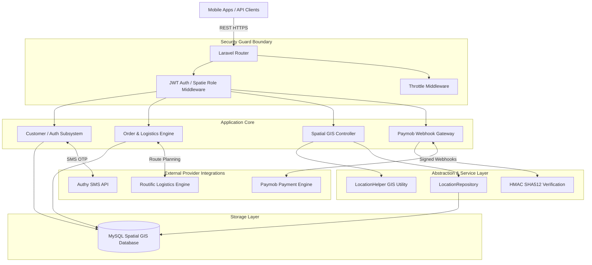
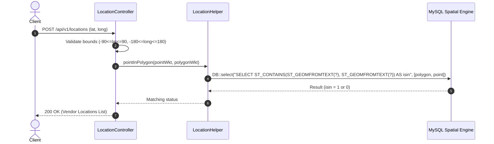

# MAKWA System — Enterprise On-Demand Laundry & Dry-Cleaning Platform

[](https://laravel.com)
[](https://php.net)
[](.github/workflows/ci.yml)
[](LICENSE)

> **MAKWA System** is a high-performance backend API powering an on-demand laundry and dry-cleaning service platform. It manages customer order lifecycles, service bag allocations, vendor dispatching, spatial GIS geofencing, dynamic promotions, digital wallets, SMS verification, and payment gateway webhooks.
>
> *Note: Historical references to `joinvip` in repository remote URLs (e.g., `https://github.com/smta2017/joinvip`) reflect legacy repository identifiers; **MAKWA System** is the official project identity.*

---

## Table of Contents
- [Business Domain & Problem](#business-domain--problem)
- [Verified Implementation Status](#verified-implementation-status)
- [System Architecture & Diagrams](#system-architecture--diagrams)
- [Technology Stack](#technology-stack)
- [Engineering Decisions & Trade-Offs](#engineering-decisions--trade-offs)
- [Safe Local Setup & Installation](#safe-local-setup--installation)
- [Environment Configuration](#environment-configuration)
- [Running Tests & Quality Assurance](#running-tests--quality-assurance)
- [API Reference & Sample Requests](#api-reference--sample-requests)
- [Security Architecture & Remediated Flaws](#security-architecture--remediated-flaws)
- [Project Limitations & Technical Debt](#project-limitations--technical-debt)
- [Deep-Dive Documentation Index](#deep-dive-documentation-index)

---

## Business Domain & Problem

In urban markets, laundry service platforms require real-time coordination between retail customers, logistics agents, independent dry-cleaning vendors, and payment providers.

**MAKWA System** solves key operational challenges:
1. **Service Boundary Coverage**: Verifying whether customer coordinates fall inside complex multi-polygon operational zones.
2. **Order Lifecycle Scheduling**: Scheduling pickup and delivery timeslots while managing service bag inventories.
3. **Financial Integrity**: Guaranteeing callback authenticity from payment providers (Paymob) and managing customer wallet balances.
4. **Multi-Role Operations**: Distinguishing permissions between retail customers, vendor operators, and system administrators.

---

## Verified Implementation Status

| Capability / Subsystem | Implementation Status | Technical Details |
|---|---|---|
| **Spatial Geofencing** | **Fully Implemented** | Native MySQL `ST_Contains` spatial GIS query engine with parameterized bindings. |
| **Password Reset Lifecycle** | **Fully Implemented** | Single-use 60-char token validation, 2-hour TTL expiration, and hash updates. |
| **Paymob Webhook Engine** | **Fully Implemented** | SHA512 HMAC signature verification protecting transaction callbacks. |
| **Credential Management** | **Fully Implemented** | Environment-backed configuration in `config/services.php` for Authy, Slack, Routific, Paymob. |
| **Mass Assignment Protection** | **Fully Implemented** | Guarded sensitive attributes (`is_verified`) on `Customer` model. |
| **Role-Based Access Control** | **Fully Implemented** | Admin management endpoints protected via `auth:admin-api` and Spatie permissions. |
| **PHP 8.4 Compatibility** | **Fully Implemented** | Injected `SuppressDeprecations` bootstrapper to support modern PHP runtimes without deprecation crashes. |
| **V1 API Controllers** | *Incomplete / Obsolete* | Unimplemented `App\Http\Controllers\Api\V1\*` routes documented as technical debt. |

---

## System Architecture & Diagrams

### High-Level System Topology



### Spatial Geofencing Request Flow



---

## Technology Stack

- **Framework**: Laravel `7.x`
- **PHP Compatibility**: PHP `^7.2.5` through PHP `8.4` (with custom deprecation handling bootstrapper)
- **Database**: MySQL 5.7+ / 8.0+ (Spatial GIS capabilities), SQLite (In-Memory for unit testing)
- **Authentication**: JWT (`tymon/jwt-auth 1.0.0-rc.5`), Spatie Permissions (`spatie/laravel-permission 3.13`)
- **Integrations**: Paymob (Payments), Authy (SMS OTP), Routific (Route Optimization), Slack (Operations Alerts)

---

## Engineering Decisions & Trade-Offs

Detailed Architecture Decision Records (ADRs) are maintained in [`docs/ENGINEERING_DECISIONS.md`](docs/ENGINEERING_DECISIONS.md). Key examples:

1. **Parameterized Spatial GIS (ADR-001)**:
   - *Problem*: Raw coordinate string interpolation in `ST_GeomFromText()` permitted SQL injection.
   - *Solution*: Converted query construction to `DB::select` parameter binding with array values (`[$polygonWkt, $pointWkt]`).
   - *Trade-Off*: Requires manually formatting WKT geometric representations before query execution.
2. **Paymob Callback HMAC Verification (ADR-002)**:
   - *Problem*: Webhook callbacks accepted transaction state changes without verifying origin authenticity.
   - *Solution*: Calculated SHA512 HMAC signature using concatenated transaction fields signed with `config('services.paymob.hmac_secret')`.
   - *Trade-Off*: Enforces strict payload field order matching Paymob's dictionary schema.
3. **Single-Use Password Reset Tokens (ADR-003)**:
   - *Problem*: Reset endpoint allowed overwriting passwords without proving possession of a reset token.
   - *Solution*: Issued cryptographically random 60-char tokens (`Str::random(60)`), verified 2-hour TTL expiration, and deleted token upon use.
   - *Trade-Off*: Requires database read/write operations on `password_resets` table per attempt.

---

## Safe Local Setup & Installation

### Prerequisites
- PHP >= 7.2.5 (or PHP 8.x)
- Composer 2.x
- SQLite3 or MySQL

### Step-by-Step Instructions

```bash
# 1. Clone the repository
git clone https://github.com/smta2017/joinvip.git
cd makwa_system

# 2. Install PHP dependencies (using tracked composer.lock)
composer install

# 3. Configure environment
cp .env.example .env
php artisan key:generate
php artisan jwt:secret

# 4. Run automated tests (uses SQLite in-memory database)
./vendor/bin/phpunit --filter SecurityRemediationTest
```

---

## Environment Configuration

Edit `.env` using safe placeholder values:

```env
APP_NAME=MAKWA_SYSTEM
APP_ENV=local
APP_DEBUG=true
APP_URL=http://localhost

DB_CONNECTION=mysql
DB_HOST=127.0.0.1
DB_PORT=3306
DB_DATABASE=makwa_dev
DB_USERNAME=root
DB_PASSWORD=secret

# External Integration Credentials (Safe Placeholders)
AUTHY_API_KEY=your_authy_key_here
SLACK_WEBHOOK_URL=https://hooks.slack.com/services/YOUR/SLACK/WEBHOOK
ROUTIFIC_BEARER_TOKEN=your_routific_bearer_token
PAYMOB_HMAC_SECRET=your_paymob_hmac_secret
```

---

## Running Tests & Quality Assurance

Automated unit tests run against an **in-memory SQLite database**, ensuring test isolation and offline reproducibility.

```bash
# Run Security Remediation Regression Tests
./vendor/bin/phpunit --filter SecurityRemediationTest

# Run PHP Syntax Verification across all classes
find app/ -name "*.php" -exec php -l {} \;

# Validate Composer metadata
composer validate
```

---

## API Reference & Sample Requests

### Paymob Webhook Callback (`POST /api/callbackhook`)

```json
{
  "type": "TRANSACTION",
  "obj": {
    "id": 9876543,
    "pending": false,
    "amount_cents": 25000,
    "success": true,
    "currency": "EGP",
    "order": { "id": 1045 }
  },
  "hmac": "computed_sha512_hmac_signature"
}
```

- **Response (`200 OK`)**: `{ "status": "success" }`
- **Response (`401 Unauthorized`)**: `{ "error": "Invalid HMAC signature" }`

---

## Security Architecture & Remediated Flaws

1. **Spatial SQL Injection (SEC-01)**: Parameterized raw string inputs using bound array parameters in `DB::select`.
2. **Account Takeover via Password Reset (SEC-02)**: Implemented token verification, single-use invalidation, and 2-hour TTL expiration in `PasswordResetController`.
3. **Paymob Callback Webhook Fraud (SEC-04)**: Enforced SHA512 HMAC verification in `paymentGateway::callback_hook`.
4. **Hardcoded Credentials (SEC-05)**: Extracted all secrets into `config/services.php`.
5. **Mass Assignment (SEC-08)**: Removed `is_verified` from `$fillable` on `Customer` model.

---

## Project Limitations & Technical Debt

1. **Unimplemented V1 API Routes**: Routes mapped to `App\Http\Controllers\Api\V1\*` in [`routes/api.php`](routes/api.php) point to missing controller classes.
2. **Database Migrations Coverage**: Database schema creation currently relies on legacy database dumps rather than comprehensive Laravel migrations.

---

## Deep-Dive Documentation Index

For detailed architectural, security, testing, and API specifications, consult the documentation suite in [`docs/`](docs/):

- 📐 [`docs/ARCHITECTURE.md`](docs/ARCHITECTURE.md) — System Architecture, Component Topologies & ER Diagrams.
- 🛡️ [`docs/SECURITY.md`](docs/SECURITY.md) — Threat Model, Remediated Flaws & Trust Boundaries.
- 🏛️ [`docs/ENGINEERING_DECISIONS.md`](docs/ENGINEERING_DECISIONS.md) — Architecture Decision Records (ADRs).
- 📋 [`docs/REMEDIATION_REPORT.md`](docs/REMEDIATION_REPORT.md) — Full Remediation Audit Report & Status Matrix.
- 🧪 [`docs/TESTING.md`](docs/TESTING.md) — Testing Strategy & Quality Verification Guide.
- 📡 [`docs/API.md`](docs/API.md) — REST API Specification & Endpoint Documentation.
