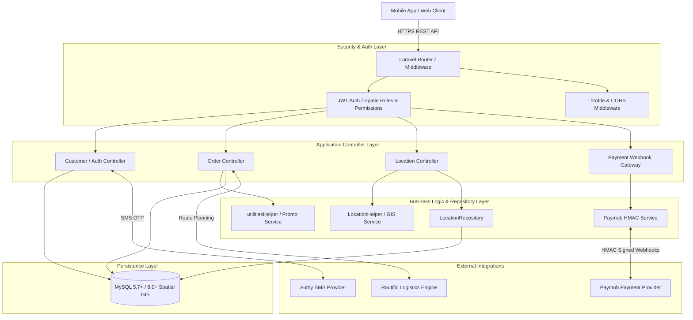
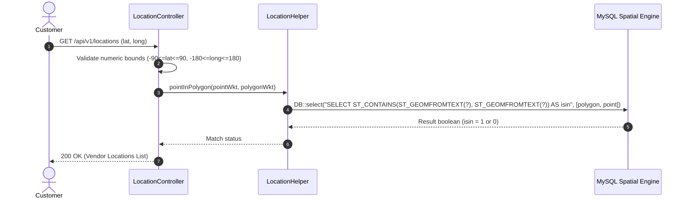
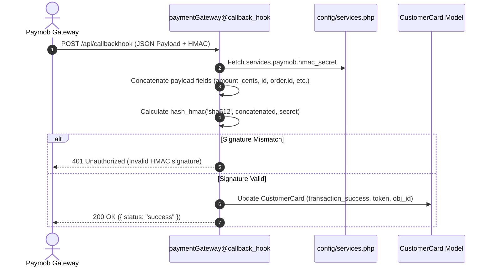
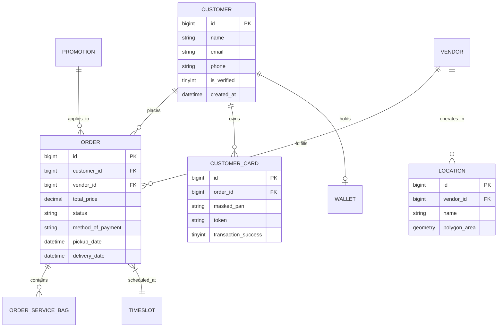

# MAKWA System — System Architecture & Design Documentation

## Executive Overview

**MAKWA System** is built on the **Laravel 7.x** MVC paradigm, enhanced with custom Repository and Helper service abstraction patterns for complex business domains including spatial GIS location verification, on-demand order dispatch, vendor allocation, dynamic promotions, customer wallets, and third-party payment gateway integrations.

---

## 1. High-Level Architecture

The system is structured as an API-first application serving customer mobile applications, vendor field applications, and administrative control panels.

---

## 2. Core Subsystems & Components

### 2.1 Spatial GIS & Geofencing Engine
- **Components**: [`LocationController`](file:///Users/sameh/projects/makwa_system/app/Http/Controllers/Api/Location/LocationController.php), [`LocationHelper`](file:///Users/sameh/projects/makwa_system/app/Http/Helper/LocationHelper.php), [`LocationRepository`](file:///Users/sameh/projects/makwa_system/app/Repositories/Location/LocationRepository.php).
- **Functionality**: Validates customer coordinates against vendor service boundary polygons using MySQL `ST_Contains(ST_GeomFromText(?), ST_GeomFromText(?))` functions. Parameterized queries prevent spatial SQL injection.

### 2.2 Payment Webhook Processing & Trust Boundary
- **Components**: [`paymentGateway`](file:///Users/sameh/projects/makwa_system/app/Http/Controllers/payment2/paymentGateway.php), `CustomerCard` model.
- **Functionality**: Receives Paymob payment callbacks at `/api/callbackhook`. Cryptographically verifies Paymob's SHA512 HMAC signature using concatenated transaction attributes before updating order transaction states.

### 2.3 Secure Password Reset Lifecycle
- **Components**: [`PasswordResetController`](file:///Users/sameh/projects/makwa_system/app/Http/Controllers/PasswordResetController.php), `password_resets` table.
- **Functionality**: Single-use token generation (`Str::random(60)`), 2-hour TTL expiration validation, server-side token lookup, password re-hashing via `Hash::make()`, and immediate token invalidation.

---

## 3. Domain Model Entity Relationships

---

## 4. Key Architectural Decisions & Trade-Offs

| Decision | Rationale | Trade-Off |
|---|---|---|
| **Parameterized Spatial GIS** | Eliminates spatial SQL injection while preserving native database GIS performance | Requires strict numeric coordinate bounds checking prior to query execution |
| **Config Service Isolation** | Removes hardcoded secrets from controller sources; allows runtime injection | Requires environment configuration management across environments |
| **JWT Authentication** | Stateless REST API authentication compatible with mobile clients | Token invalidation before expiry requires server-side blacklist tracking |
| **SQLite Testing Database** | Enables isolated, fast, offline unit test execution without external DB dependencies | Requires maintaining migrations/table definitions compatible with SQLite |
